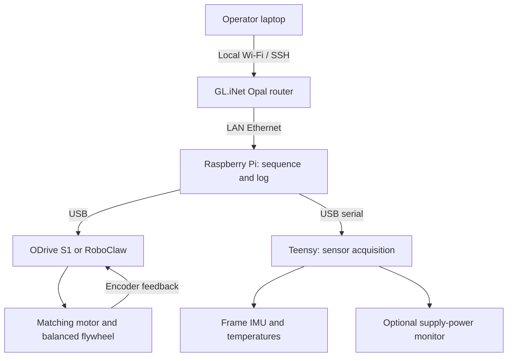

# Microgravity Experiment Design — Complete Team Handoff

**Updated:** November 18, 2026  
**Project:** Gravity-dependent friction characterization of a rotary actuator  
**Team:** Andres, Emiliano, Alex, Sebastian, Matt, Jonathan  
**Purpose:** Give every teammate and their AI/software work sessions enough context to continue independently and integrate their work.  
**Planning horizon:** Approximately three weeks remaining, as reported on November 17. Confirm the exact course submission date with Andres.

## 1. Read this first

We are building a ground-based proof of concept that measures actuator effort versus rotational speed under different gravity-induced bearing-load directions. A balanced flywheel remains directly attached to the motor, loading its bearings. We compare stationary horizontal/vertical orientations and fit a friction model where the measurements support it. We are not building a robot arm, and ground orientation tests are not measurements of microgravity. [S01, S02]

Procurement changed the implementation. The previously selected Maxon DCX22S/ENX16/ESCON combination is no longer the baseline because of stock/lead-time problems. The team ordered a **Pittman 9236S009-SP brushed motor and RoboClaw 2x7A controller**, but, at the latest team update, neither had arrived. We will begin with Andres's existing **ODrive S1 + M8325s brushless motor** and develop a complete working experiment around available hardware. Qualify the incoming parts before deciding to switch. [C01]

**Current implementation direction:** host computer, initially a laptop and eventually the Raspberry Pi, communicates directly with the selected motor controller over USB. The Teensy independently acquires IMU/temperature/other sensor data and sends it to the host over a separate USB connection. Shared logging, sequencing, units, and analysis should survive the motor change. The motor controller performs the motor's inner control loops. [C01; S06–S09]

**Priority:** a safe, repeatable, logged physical demonstration and defensible analysis. Advanced modeling, custom analog motor interfaces, ROS integration, simulation, and automatic orientation are secondary. No new subsystem should delay the first real motor dataset unless it is needed to operate safely or interpret that dataset.

This document distinguishes:

- **Recorded:** explicitly present in source documents or the project conversation.
- **Current plan:** the agreed direction or recommendations developed in this conversation; implementation still needs demonstration.
- **Proposed:** concrete conventions and acceptance criteria supplied here to make parallel work practical; confirm at the team meeting.
- **Unverified:** inspect, measure, or consult the exact hardware documentation before use.

An architecture diagram, code example, generated schematic, or checklist is not evidence that hardware has been assembled or tested.

## 2. Source precedence and project record

Use these rules when continuing work:

1. Exact manufacturer documentation and the hardware actually received determine pinouts, ratings, and supported behavior.
2. Current team decisions in this handoff supersede older architecture requirements.
3. Historical handoffs explain the rationale and preserve earlier component choices; their use of “final” or “mandatory” referred to that earlier design stage.
4. Proposed mappings, sample rates, timing tolerances, safe limits, and software interfaces remain proposals until verified and recorded in the as-built configuration.

The two principal handoff sources reviewed were `microgravity_experiment_design_project_summary.md` (October 5) and `microgravity_kicad_work_handoff.md` (October 26). A same-size copy named `microgravity_kicad_work_handoff(1).md` is also in the project records; it was not independently compared byte-for-byte. The project source collection also contains motor/controller PDFs, a Maxon order email PDF, KiCad archives/PDF, FROST reference files, and controller software archives. [S01–S05]

### Development history

| Stage | Recorded outcome | Present relevance |
|---|---|---|
| Original concept | Investigate whether terrestrial friction-compensation parameters transfer toward reduced gravity | Science motivation remains |
| Scope reduction | Replace a robot-arm concept with one motor and balanced flywheel | Keep this limited scope |
| Early component research | Maxon A-max 22, separate encoder, Pololu driver; other integrated actuators considered | Historical candidates only |
| October electrical plan | Maxon DCX22S + ENX16 + ESCON, Teensy analog command/acquisition, Pi logger/router | Preserve reusable power/sensor/network work |
| KiCad development | Native schematic archives and PDF generated; later request emphasized a fully interconnected assembly schematic in the style of FROST | Existing documents need reconciliation with current hardware |
| November procurement change | Pittman + RoboClaw selected; INA228 unavailable | Replacement interfaces and calibration required |
| November contingency | ODrive S1/M8325s available; incoming motor/controller still awaited | Build/test now, qualify replacements later |
| Current organization | Four coordinated workstreams with named owners | See Section 13 |

### Existing artifacts

- `microgravity_experiment_design_project_summary.md`: original science question, rationale, model, tests, literature and simulation ideas.
- `microgravity_kicad_work_handoff.md` and its `(1)` copy: detailed October electrical requirements and source references.
- `Microgravity_Friction_Experiment.zip`: generated KiCad archive; project record shows a later October 27 update.
- `Microgravity_Friction_Experiment(1).zip`: separately uploaded archive; do not assume it is the latest design just because of the suffix.
- `Microgravity_Friction_Experiment.pdf`: earlier exported schematic reference; do not assume it matches the later archive revision.
- `FROST.zip`, `FROST.kicad_sch`, `frost_diagram.pdf`: prior-project style/reference material. FROST's CAN choices are not requirements for this experiment.
- `Ametek_Pittman_9236S009.pdf`, `roboclaw_datasheet_2x7A.pdf`, `roboclaw_user_manual.pdf`: incoming-hardware references.
- `roboclaw_python.zip`, `arduino.zip`, `RoboclawClassLib.zip`, `Roboclaw_LabViewInstrDriver.zip`, `USBRoboclawVirtualComport.zip`: supplied programming/driver resources; possession does not establish installation or compatibility.
- `EN_maxon ESCON_EPOS4 practice.pdf`, `Cataloge-Page-EN-112.pdf`, Maxon order-confirmation email PDF: historical hardware/order references.
- `DC Motor–Flywheel Friction Experiment.png`: concept illustration, not a manufacturing drawing.

**Confirmed development limits:** no measured friction curves, completed current-hardware commissioning, final flywheel geometry, final PCB/protoboard, or finished software repository was supplied as evidence for this handoff. Record those as pending, not complete. Maxon cancellation/refund status and the supply-monitor purchase status are also unconfirmed. [C01; S01–S05]

## 3. Scientific objective and original planning

### 3.1 Question and hypothesis

**Science question:** How does gravity-induced mechanical loading affect the experimentally identified friction characteristics of a rotary motor/joint, and which lumped friction-model components are most sensitive?

**Hypothesis:** Changing radial versus axial gravitational bearing loading may change the effort-versus-speed curve. The earlier plan predicted a stronger effect on breakaway/Stribeck/Coulomb-like terms than on a purely viscous term. This is a prediction to test, not an established result. A null or unresolved result is scientifically acceptable if the measurement uncertainty is documented. [S01, S02]

The original course scope was approximately 3–4 months with a roughly **2 ft × 3 ft** apparatus footprint. The older estimate of 4–5 teammates is superseded by the present six-person team. The apparatus is intended to function autonomously as a conceptual parabolic-flight experiment, but actual flight is not expected for the course. It is not flight-qualified. [S01, S02, C01]

### 3.2 Why a balanced flywheel

For a rotor balanced about its spin axis, its weight creates little gravitational torque about that axis, while still loading the supporting bearings. This reduces the large pendulum-like gravity torque that would complicate a one-link arm experiment. The motor remains mechanically connected throughout measurement because its losses are part of the system being identified. Fully supporting the flywheel on separate external bearings would divert the gravity-load path away from the motor bearings. [S01, S02]

This experiment identifies **lumped actuator/rotor losses**. Depending on hardware and speed, these can include bearings, brushes, lubrication, magnetic/core effects, cogging-related behavior, and air drag. Fitted terms do not uniquely identify individual microscopic mechanisms. Results and constants are specific to the tested assembly. [S01, S02]

### 3.3 Governing relations

With a declared torque/sign convention:

\[
\tau_m = J_{\mathrm{total}}\dot\omega + \tau_{\mathrm{loss}} + \tau_{\mathrm{other}}.
\]

At a validated steady-speed plateau with negligible additional shaft torque:

\[
\tau_{\mathrm{loss}} \approx \tau_m.
\]

For the brushed motor, electromagnetic torque is approximated by \(K_t I_{\mathrm{armature}}\). For the ODrive/brushless setup, use the appropriate calibrated torque constant and measured torque-generating q-axis current. Do not substitute DC supply current or a commanded current for either measurement. Spin-up current also supplies inertial torque and cannot all be called friction. [S02, S08, S11]

A candidate signed Stribeck/Coulomb/viscous model, for nonzero speed, is:

\[
\tau_f(\omega)=\left[T_C+(T_S-T_C)e^{-(|\omega|/\omega_s)^\alpha}\right]\operatorname{sgn}(\omega)+b\omega.
\]

Here \(T_C\) is Coulomb-like torque, \(T_S\) the low-speed limiting level, \(\omega_s\) a transition speed, \(\alpha\) a shape parameter, and \(b\) a viscous-like coefficient. Define whether reported \(\tau_f\) is the drive torque required to balance losses or the opposing physical torque; do not mix conventions. The moving-friction equation does not by itself describe static friction at exactly zero speed. A separate breakaway test is needed. MathWorks documents a related smooth Stribeck/Coulomb/viscous formulation; it is not numerically identical to this proposed exponential model. [S02, S12]

**Analysis recommendation:** begin with effort-versus-speed plots and repeatability. Fit Coulomb-plus-viscous behavior first if appropriate; add Stribeck parameters only when low-speed coverage and signal quality make them identifiable. Avoid fitting every parameter to a few noisy points.

### 3.4 Gravity-load interpretation

For stationary Earth tests, let \(\hat{\mathbf s}\) be the shaft-axis unit vector expressed in the calibrated IMU frame and \(\mathbf a\) the quasi-static accelerometer vector. Approximate flywheel-weight components are:

\[
F_a \approx m|\mathbf a\cdot\hat{\mathbf s}|,\qquad
F_r \approx m\sqrt{\max(0,|\mathbf a|^2-(\mathbf a\cdot\hat{\mathbf s})^2)}.
\]

These are approximate weight components, not a complete calculation of individual bearing reactions. Bearing spacing, overhang, rotor weight, preload, cable forces and housing geometry matter. Preserve a signed axial projection or orientation label if comparing opposite thrust directions. During dynamic motion or flight, an accelerometer measures specific force; its output is not an independent measurement of absolute gravitational field. [S02, S13]

| Condition | Intended comparison |
|---|---|
| Shaft horizontal | Primarily radial flywheel-weight loading |
| Shaft vertical | Primarily axial loading |
| Opposite vertical direction | Opposite axial-load direction |
| Indexed inverted horizontal orientation | Radial-direction symmetry/repeatability check |
| Hypothetical reduced gravity | Reduced flywheel-weight contribution, not removal of every preload/loss |

Earth orientation tests change load direction while leaving flywheel weight magnitude approximately \(mg\). They cannot establish a measured zero-g friction curve. Reorient only with the flywheel stopped; hold the frame stationary during acquisition. A spinning rotor resists changes of axis through gyroscopic torque, introducing an additional load. [S01, S02]

### 3.5 Research and alternatives retained from original planning

- **One-link arm:** rejected to reduce dynamics/control and fabrication scope.
- **Direct-drive brushed motor:** preferred for a relatively simple current-to-torque model and available datasheet parameters.
- **DYNAMIXEL/geared integrated actuator:** considered, but gearbox and embedded servo behavior add losses and obscure the measurement chain.
- **Pololu direct-drive motor:** considered; original notes favored a more completely specified motor for inertia, torque constant and allowable loading.
- **Maxon A-max 22 P/N 110147:** early candidate, subsequently replaced by the DCX22S order. Historical values from the October science summary include 12 V, approximately 10,200 rpm no-load, 45.8 mA no-load, 6.96 mNm continuous torque, 0.681 A continuous current, 23.7 mNm stall torque, 2.17 A stall current, 5.53 ohm resistance, 0.363 mH inductance, 10.9 mNm/A torque constant and 4.29 g·cm² rotor inertia. These are archived notes, not settings for either current motor.
- **Same Sky/CUI AMT102-V encoder:** early separate-encoder candidate, selectable up to 2048 pulses/revolution in the original notes; superseded by selected motor feedback arrangements.
- **Pololu DRV8876 carrier:** early brushed-driver option with current limiting/sense; superseded by ESCON and then RoboClaw.
- **ODrive S1/M8325s:** originally set aside to simplify the science hardware; now the practical backup because it is available.

All candidate history above is from the original project record; it is not a new procurement recommendation. [S01, S02, C01]

## 4. Procurement change and present hardware choices

### 4.1 Maxon order and its replacement

The later selected Maxon combination was **DCX22S GB KL 12 V + ENX16 EASY 1024 IMP**, configuration **B845DD013EB0**, with **ESCON 36/2 DC P/N 403112**. This differs from the earlier A-max candidate. The order-email source records a November 4 order and a November 9 confirmation correspondence. The receipt states up to 20 working days to produce and up to 25 working days for delivery, subject to final confirmation. That is historical ordering language, not a verified current ETA. The team reported stock/lead time made this path unsuitable. **Do not assume cancellation has been completed.** [S02, S05, C01]

The selected replacement is:

- [Pittman 9236S009-SP motor](https://servocomponents.com/products/ametek-haydon-kerk-pittman-9236s009-sp).
- [Basicmicro RoboClaw 2x7A, IMC404](https://www.basicmicro.com/Roboclaw-2x7A-Motor-Controller_p_55.html).

The team reported that both were ordered and that shipping labels had been created. Arrival, carrier acceptance scans, and delivery dates were not verified in this handoff. Tracking references supplied by Andres: Basicmicro UPS **1Z708TT40393795727**; Servo Components UPS **1ZW434230333157337**. Ground-shipping estimates must not be used as integration commitments. [C01]

### 4.2 Pittman motor: reference parameters and revision discrepancy

The storefront calls the part **9236S009-SP**. The supplied and storefront-linked PDF is headed **9236S009-R1-SP**. The storefront lists **4,913 rpm** no-load, while that PDF lists **4,820 rpm**. Confirm the motor label and applicable drawing with the supplier before final configuration. Values below are the **uploaded PDF's nominal 25°C reference values**, not measurements of the received motor. Peak quantities are theoretical in that PDF. [S03, S06]

| Parameter | PDF reference value |
|---|---:|
| Motor type | Series 9000 LO-COG brushed DC, direct drive |
| Supply/reference voltage | 24 V |
| Continuous output torque | 9.5 oz-in |
| Speed at continuous torque | 3,980 rpm |
| Current at continuous torque | 1.8 A |
| Continuous output power | 28 W |
| No-load current | 0.16 A |
| No-load speed | 4,820 rpm |
| Peak current / torque | 9.6 A / 62 oz-in |
| Torque constant | 6.49 oz-in/A |
| Voltage constant | 4.8 V/krpm |
| Terminal resistance / inductance | 2.49 ohm / 2.6 mH |
| Listed Coulomb friction torque | 0.8 oz-in |
| Listed viscous damping | 0.053 oz-in/krpm |
| Motor constant | 4.11 oz-in/√W |
| Electrical / mechanical time constant | 1.1 ms / 8.4 ms |
| Thermal time constant / resistance | 14 min / 14°C/W |
| Maximum winding temperature | 155°C |
| Rotor inertia | 0.001 oz-in-s² |
| Bearing / gearing | Ball / none |
| Encoder | E30B, 500 CPR, three channels |
| Mass | 16 oz |
| Mounting face diameter | 1.58 in reference frame size |

Useful conversions, using \(1\ \mathrm{oz\!\cdot\!in}=0.00706155\ \mathrm{N\!\cdot\!m}\):

- \(K_t=6.49\times0.00706155\approx0.04583\ \mathrm{N\!\cdot\!m/A}\).
- Continuous output torque \(9.5\times0.00706155\approx0.06708\ \mathrm{N\!\cdot\!m}\).
- Listed Coulomb torque \(0.8\times0.00706155\approx0.005649\ \mathrm{N\!\cdot\!m}\).

Datasheet shaft output torque and electromagnetic torque need not coincide because internal losses are present. Do not derive an alternative torque constant simply by dividing the continuous output-torque row by its current row. Manufacturer friction rows are reference values, not substitutes for the experiment. [S03, S11]

Drawing details to check physically: approximately **3.965–3.972 mm shaft diameter**, **four #6-32 UNC-2B mounting holes on a 25.4 mm bolt circle**, and **8.89 mm maximum screw penetration**. Preserve the actual drawing for hub fit, shaft extension and tolerances. The encoder drawing maps **red: Vcc, black: encoder ground, yellow: A, blue: B, green: index**. Verify supply voltage, output type, connector orientation and wire identity before applying power. Wire colors alone are insufficient verification. [S03]

**Encoder scaling:** if “500 CPR” denotes 500 A-channel cycles/revolution and the controller counts all four quadrature edges, the result is 2,000 counts/revolution. Confirm by physically rotating one turn; do not assume CPR terminology or x4 treatment. With measured \(N\) counts/revolution:

\[
\omega=2\pi\,\frac{\mathrm{counts/s}}{N},\qquad
\mathrm{rpm}=60\,\frac{\mathrm{counts/s}}{N}.
\]

### 4.3 RoboClaw: role and constraints

The 2x7A is a dual brushed-DC controller; only one motor channel is required. The uploaded datasheet specifies **6–34 V main supply**, **7.5 A continuous and 15 A peak per channel**, subject to cooling/temperature. The controller's current capacity exceeds the Pittman motor's continuous rating; motor and mechanical limits govern. It supports encoder feedback, onboard velocity control, USB and packet serial, and motor-current telemetry. Motion Studio is the commissioning/configuration tool. [S04, S07]

Planned runtime path: Pi/laptop USB → RoboClaw → motor channel 1; motor encoder → RoboClaw encoder channel 1. Leave channel 2 unused. USB communication does not supply motor operating power. Inspect the actual PCB revision and manual before wiring B+/B−, M1 terminals, encoder power/A/B and configurable stop inputs. A reversed feedback direction can create runaway; verify at very low energy before closing the velocity loop. [S04, S07]

Use the official Python library/examples as the starting point; check their exact API and return/error conventions before writing the adapter. Current packet command 49 in the uploaded manual reports increments of **10 mA**, with amps obtained by dividing the returned value by 100. Using the PDF torque constant, one current code step corresponds to:

\[
0.010\ \mathrm A\times0.04583\ \mathrm{N\!\cdot\!m/A}
\approx0.0004583\ \mathrm{N\!\cdot\!m}=0.4583\ \mathrm{mN\!\cdot\!m}.
\]

That is reporting granularity, not guaranteed accuracy or a proven noise floor. Qualify offset, repeatability, sign/direction behavior, filtering and actual update rate before concluding a small orientation effect is resolvable. Averaging does not automatically recover information below quantization. [S04]

### 4.4 Existing ODrive backup

Use the **ODrive S1 with its compatible M8325s brushless motor**, not the Pittman motor. ODrive is the controller, not a motor model. The S1/M8325s kit guide covers its motor, feedback/mounting arrangement, thermal assembly and wiring; it specifies a USB isolator for computer connection. The S1 datasheet specifies **12–50.5 V DC input**, so the proposed battery is within its input-voltage range, subject to proper configuration and protection. [S08, S09]

Important mechanical distinction: the M8325s product guidance specifies transmitting torque through the motor-shell face using the **M3 / 31 mm bolt circle**. Do not attach a flywheel to a small locating feature as if it were the Pittman's output shaft. Alex must provide an appropriate hub/attachment for each motor and check the bearing/load path. [S10]

For effort logging, the current ODrive API documents `axis0.motor.foc.Iq_measured` as torque-generating current and `axis0.motor.torque_estimate` as a current/torque-constant estimate. Verify paths against the installed firmware. Record the motor's configured torque constant and reporting filters. The estimate is not an independent torque transducer. [S08]

The backup supports speed sweeps, sensor/logging integration, repeatability studies, and an apparatus demonstration. A brushless setup can have low-speed cogging/control effects that complicate a smooth friction fit. Inspect position-dependent ripple and repeat both directions; identify results as belonging to the ODrive/M8325s assembly. ODrive data cannot be relabeled as Pittman calibration. [S01, S02; analysis recommendation]

### 4.5 Operating from the 20 V battery

The selected DeWalt DCB205 is marketed as **20 V MAX**, with **18 V nominal** in the project power plan. It is not a regulated 20 V source. Its voltage range is compatible in principle with both controllers' documented inputs; that does not validate the full power harness or regeneration behavior. [S02, S04, S09]

Running the 24 V Pittman below 24 V changes available speed/power and the reachable torque-speed operating region. The listed 24 V speed/performance values no longer apply directly. The approximate brushed model is:

\[
V_{\mathrm{motor}}\approx RI+L\dot I+K_e\omega.
\]

Lower voltage reduces high-speed current/torque headroom. Torque constant, inertia and geometry do not all scale with supply voltage; temperature and operating conditions still affect motor behavior. The experiment can operate at lower steady speeds if they are controllable and scientifically useful. Validate the actual range on the bench. A “20 V battery works” statement is not permission to use stall current, maximum speed or aggressive braking. [S03, S11; engineering interpretation]

### 4.6 INA228 replacement

The TA reported the Adafruit INA228 board was unavailable. **INA238, Adafruit 6349**, is the preferred replacement discussed in the subsequent planning record; confirm which board was actually ordered. It is an I²C voltage/current/power monitor with **85 V bus capability and 16-bit conversion**, rather than the INA228's 20-bit conversion. It needs its own correct driver/calibration and board-specific shunt/terminal checks. [C01, S14]

INA219 was an earlier alternative considered, but Adafruit's standard board is limited to **26 V and ±3.2 A**. Those limits provide less transient/current margin for this regenerative motor branch; do not substitute it without reviewing the actual branch conditions. Omitting this optional supply monitor initially is preferable to delaying the motor experiment. [S14; implementation recommendation]

**Purpose:** secondary controller-input voltage/current/power telemetry. Place it in the selected controller's supply branch, not in PWM motor phase/leads and not in the combined Pi/router branch if interpreting controller input power. Supply current and motor torque current are different. Neither INA238 nor INA219 replaces the controller's motor-current measurement for the primary torque inference. [S02, S04]

## 5. Current system architecture

The following is the current plan, not a verified as-built diagram. [C01]



### What remains common and what changes

| Subsystem | Reusable across motor choices | Motor-specific work |
|---|---|---|
| Power | Protected battery entry, suitable 5 V distribution | Branch sizing, current/voltage limits, regen handling |
| Mechanics | Base, guard concept, indexed orientations | Motor plate, hub, load path, permitted inertia/speed |
| Sensor circuit | IMU, thermistors, Teensy, USB framing | Temperature placement and thermal interpretation |
| Host software | Sequencer, logger, configuration, plotting | ODrive/RoboClaw adapter and API handling |
| Measurement semantics | Common units and metadata | Current definition, calibration, encoder scaling |
| Analysis | Plateau selection, repeatability, fitting code | Motor constants and separate datasets |
| Stop behavior | Default-disarmed policy and tested physical controls | Actual controller wiring/configuration and coast/brake response |

Do not try to make the ODrive reproduce ESCON's analog monitor voltages or the RoboClaw's electrical interface. Preserve a software-level interface and calibrated physical quantities. The controllers, motor harnesses, encoder arrangements and mechanical interfaces are not drop-in equivalents.

No CAN link is required for the current plan. The controller closes the fast loop locally; Linux/USB is for supervisory commands and telemetry, not a custom high-rate current-control loop. [C01, S02, S07–S09]

## 6. Electrical, sensor and power requirements

### 6.1 Inventory and historical budget

The October purchased-component budget was approximately **$1,000**, with a listed subtotal **$825.87**, leaving **$174.13** before tax/shipping. It is obsolete as a current accounting total after motor substitutions. Prices below preserve that planning record, not current quotes or proof of receipt. [S02]

| Component | Quantity / identity | Historical listed cost | Current role |
|---|---|---:|---|
| Maxon motor/encoder/controller bundle | B845DD013EB0 + 403112 | $595.49 | Historical; cancellation status unknown |
| INA228 | Adafruit 5832, one | $15.00 | Unavailable per TA; replacement/omission |
| Teensy 4.0 with pins | One | $29.80 | Sensor acquisition |
| Raspberry Pi 4B | Owned | $0 | Autonomous host/logger |
| Battery | DCB205, 5 Ah | $65.39 | Standalone power |
| Battery adapter | CHoiKWong B0B4FS1NV1, two-pack | $14.99 | Raw power interface; protection unverified |
| 5 V buck | DROK 200108 | $8.50 | Pi/router power |
| NTC thermistors | Five TDK B57861S0103H040 | $7.87 total | Thermal metadata |
| IMU | Adafruit 4503, LSM6DS3TR-C | $9.95 | Frame orientation/disturbance |
| MCP4725 DAC | Adafruit 935 | $4.95 | Historical ESCON setpoint; optional bench tool now |
| ADS1115 ADC | Adafruit 1085 | $14.95 | Historical ESCON monitor acquisition; optional now |
| Router | GL.iNet Opal GL-SFT1200 | $39.99 | Local LAN/Wi-Fi access |
| Three-position selector | Listing B09MYX3R5F | $18.99 | Mode selection; contacts unverified |

Lab-supplied materials contemplated include resistors, wiring, connectors, protection/interface parts, protoboard, fabrication and mounting hardware. Record the revised BOM and receipts separately. The Maxon receipt added $80.60 shipping to the $595.49 bundle, totaling $676.09; this was not included in the historical $825.87 component subtotal. [S02, S05]

### 6.2 Power distribution

Current design requirements carried forward from the electrical handoff:

1. Verify adapter polarity with a meter. Fit a DC-rated fuse close to battery positive and a physical master disconnect. Choose protection/wire ratings from actual branch currents and fault conditions, not a copied preliminary value.
2. Split protected battery power into the selected motor-controller branch and the 5 V buck input branch.
3. Power Pi and router through properly implemented USB-C power leads from the 5 V distribution. Pi powers Teensy over USB in the baseline.
4. Keep motor-current returns out of sensor reference wiring. Use deliberate common references where the interfaces require them; do not create fictitious isolated grounds without isolation hardware.
5. Verify undervoltage protection. A generic battery adapter is not assumed to implement the protection a DeWalt tool provides.
6. Account for regenerated flywheel energy, \(E=\tfrac12J\omega^2\), and the DC source's ability to absorb it. A bench supply may not sink current; a battery/BMS may reject it under some states. Follow the selected controller's instructions for braking/clamping and safe disconnection.
7. Test startup, deceleration, source loss and disconnect behavior at low energy before increasing speed/inertia. Preserve useful logging during motor disarm where practicable.

These are design requirements, not claims that protection is installed. RoboClaw and ODrive require different controller-specific regen/stop implementations; do not copy an ESCON, diode or brake-resistor circuit across controllers without checking its applicability. [S02, S04, S09]

The DROK 200108 was selected as a fixed **5 V, 10 A / 50 W** buck. Its historical product description had inconsistent input-range wording; the earlier handoff used **10–35 V conservatively**, pending inspection. Verify the label, polarity and actual output. A nominal rating does not guarantee adequate voltage at the Pi after cable drop. Test at the powered Pi/router under load. The Pi 4B reference supply recommendation is 5.1 V/3 A. [S02, S16]

Avoid simultaneously powering Teensy VIN and USB unless PJRC's VUSB/VIN isolation procedure is followed. Do not use either motor controller's accessory output to power the entire Pi/router stack without a documented power budget. Teensy 4.0 signals are **3.3 V and not 5 V tolerant**. [S02, S15]

### 6.3 Teensy and sensors

The following assignments are **proposed project GPIO mappings from the earlier handoff**, retained where useful. Confirm the actual wiring and firmware. [S02, S15]

| Function | Teensy pin / interface | Notes |
|---|---|---|
| Host data/power | Native Micro-USB | Separate host connection from motor controller |
| I²C SDA/SCL | 18 / 19 | 3.3 V bus; begin conservatively at 100 kHz |
| Thermistor T1 | 14 / A0 | Motor housing near output bearing |
| T2 | 15 / A1 | Opposite motor housing/bearing region |
| T3 | 16 / A2 | Controller vicinity |
| T4 | 17 / A3 | Electronics enclosure |
| T5 | 20 / A6 | Ambient/fixture reference |
| Selector inputs | 4 / 5 | Actual switch truth table must be measured |
| Optional heartbeat | 6 | Only if implemented/documented |
| Historical ESCON enable | 3 | Do not reuse as a generic controller enable without design review |
| Historical ESCON PWM | 2 | Inactive in current USB plan |

**IMU:** Adafruit LSM6DS3TR-C, default I²C address 0x6A in the earlier plan, with 0x6B selectable. Mount rigidly on the nonrotating motor frame, record axes and shaft direction. The IMU gyro detects fixture rotation, not rotor speed. Use the motor encoder for rotor speed. Check the actual breakout's pinout and bus pull-ups. [S02, S17]

**Thermistors:** TDK B57861S0103H040, nominal 10 kohm at 25°C; the earlier source specifies approximately B25/100 = 3988 K, ±3% resistance and ±1% B tolerance. Use the actual datasheet curve/calibration. Proposed divider: fixed 10 kohm from 3.3 V to sense node; NTC from sense node to ground. Then:

\[
R_{NTC}=R_F\frac{V_{sense}}{V_{exc}-V_{sense}},\quad
\frac1T=\frac1{298.15}+\frac1B\ln\left(\frac{R_{NTC}}{10{,}000}\right).
\]

Temperatures in the beta equation are kelvin; subtract 273.15 for °C. Retain measured resistor values, excitation/reference assumptions and raw ADC readings. Detect open/short sensors; consider self-heating, filtering and thermal contact. Mount no sensor wires on rotating parts. [S02, S18]

**I²C inventory:** earlier defaults were IMU 0x6A, ADS1115 0x48, MCP4725 0x62, INA228 0x40. Verify the replacement INA238 address/straps and driver separately. Only populate needed devices; inspect parallel pull-ups and power-off backfeeding. ADS1115 has four multiplexed inputs, not five simultaneous thermistor channels. [S02, S14]

### 6.4 What the electronics team can do before motor delivery

- Bring up the protected logic-power branch, Pi/router/Teensy and independent sensor logging.
- Substitute precision resistors for thermistors to validate resistance/temperature calculations and open/short detection.
- Use known fixture orientations to check IMU axes, signs and stationary-state detection.
- Inject safe analog test signals into any retained ADC path; verify scaling, offset, clipping and noise with a meter/scope.
- Generate simulated serial motor frames or a software mock to exercise sequencing, plots, timeouts, dropped samples and log files.
- Validate DAC output with a meter/scope if needed as a bench source; do not develop an unnecessary analog motor interface just because the part is available.
- Build the shared power/sensor harness and labeled connectors, with the controller-specific harness kept replaceable.

These are proposed bench tasks. A function generator and synthetic data validate an acquisition chain or software behavior; they do not validate real motor-current accuracy, PWM noise, regeneration, torque calibration or bearing-load sensitivity. Repeat those checks with the physical drive. Respect voltage ranges and earth-grounded instrument connections. [S02; current implementation plan]

## 7. Historical ESCON analog design — reference only

This section preserves the earlier design so future chats can interpret the old schematic. **It is not the wiring plan for ODrive or RoboClaw.** [S02]

The original path was Teensy → MCP4725 analog command → ESCON; ENX16 → ESCON feedback; ESCON current/speed analog monitors → bipolar conditioning → ADS1115 → Teensy → USB → Pi. ESCON USB was used for configuration with Windows ESCON Studio, not normal analog-runtime commands.

### Archived connector assignments

| ESCON connector | Historical functions |
|---|---|
| J1 | Pin 1 power GND; pin 2 +VCC |
| J2 | Pin 1 +M; pin 2 −M; pin 3 motor shield |
| J2A | Alternative motor terminals, 1 +M / 2 −M |
| J4 | 1 motor +M and 4 motor −M only for the applicable integrated cable; 2 encoder +5 V; 3 encoder GND; 5 A−; 6 A+; 7 B−; 8 B+; 9/10 NC |
| J4A | Encoder signals as above; pins 1/4 not motor connections; 9/10 NC |
| J5 | 1 DigIN1; 2 DigIN2; 3/4 configurable digital I/O; 5 GND; 6 controller +5 V AUX |
| J6 | 1 AnIN1+; 2 AnIN1−; 3 AnIN2+; 4 AnIN2−; 5 AnOUT1; 6 AnOUT2; 7 GND |
| J7 | Configuration USB |

The handoff cites ESCON 403112 hardware reference edition 2021-08 as authority. It required correct J2/J4 cable-option and JP1 settings, and warned not to treat J4 pins 9/10 as encoder index. Do not fabricate a Maxon harness from this compact table alone. The historical controller rating was 10–36 V, 2 A continuous/4 A short-term. [S02, S19]

**Historical analog settings:** MCP4725 powered at 3.3 V, VOUT to J6-1, with J6-2 referenced to J6-7. A possible 1.65 V zero/signed-speed mapping was a proposal, not a factory default. J5-2 was intended to be configured as enable through an independent interlock. Optional PWM on J5-1 was an alternative, never a simultaneous second command source. [S02]

ESCON AnOUT1/2 were to be configured for averaged actual current and actual speed. They can reach **−4 to +4 V**. The ADS1115 differential/PGA setting does not permit arbitrary negative input voltage relative to its ground. Historical target conditioning was:

\[
V_{ADC}=1.65+0.375V_{ESCON},
\]

mapping −4/0/+4 V to 0.15/1.65/3.15 V. This was a target transfer, not proof of a fabricated/validated conditioner. The earlier requirements included input clamps, power-off protection, suitable op-amp/reference behavior, anti-alias filtering and output-loading checks (ESCON output ≤1 mA and ≤10 nF in the cited reference). ADS1115's maximum 860 SPS is an aggregate multiplexed conversion rate, not simultaneous 860 SPS per channel. More ADC bits cannot restore information lost in the controller's analog monitor. [S02, S20]

The October handoff cited representative DCX22S values of 9.18 mNm/A torque constant, 5.05 g·cm² rotor inertia, approximately 1.65 A continuous current and 14.6 mNm continuous torque, subject to exact configuration. ENX16 was 1024 impulses/revolution, conditionally 4096 x4 transitions. These values belong to the historical Maxon configuration and must never be loaded into Pittman or M8325s settings. [S02]

## 8. Software stack and common interfaces

### 8.1 Minimum software scope

**Recommended baseline:** a small Python host application with a motor adapter, independent sensor reader, experiment sequencer, logger and offline analysis. Pin working dependencies and record versions. No ROS, custom GUI, database, custom motor firmware or simulation is required for the proof of concept. Use one owner/process per physical serial device; prevent two clients from issuing competing commands. [C01; proposed implementation]

Suggested modules, not existing files:

| Module | Responsibility |
|---|---|
| `motor_odrive` | ODrive command, feedback, faults, unit conversion |
| `motor_roboclaw` | RoboClaw command, feedback, faults, encoder conversion |
| `motor_mock` | Deterministic synthetic motor data and injected failures |
| `sensors_teensy` | Parse/version-check sensor frames; timestamps and validity |
| `sequencer` | Explicit states, ramps/plateaus, abort/stop policy |
| `logger` | Preserve raw streams, commands, metadata and events |
| `analysis` | Plateau selection, effort conversion, plots, uncertainty, fits |
| `config` | Motor-specific constants, tested limits and device identity |

### 8.2 Proposed motor interface

Agree a minimal interface before separate development:

```python
connect(config)
arm()
set_speed_rad_s(target)
read_feedback()
stop()
disarm()
close()
```

`read_feedback()` should return measured speed, the available current/effort quantity, current-kind label, fault/status fields, source timestamps if available, and host acquisition times. Position, bus voltage and temperature are optional capabilities. An unsupported value must be null/unavailable, not zero. Add current/torque-control methods only if the selected controller genuinely supports the required experiment; do not claim a shared current-control capability merely because ODrive has it.

`stop()` and `disarm()` need separately documented meanings. Zero target speed with an enabled velocity loop can actively brake/hold. Disarming may coast. Neither is automatically a characterized open-circuit coast-down condition. Validate behavior for each controller and expose any deliberate coast mode explicitly. [S01, S04, S08; interface proposal]

The adapter should convert native units to **rad/s, rad, A, N·m, V, °C and seconds** where applicable, while preserving raw values. ODrive commonly uses turns/s; RoboClaw encoder speed is counts/s. Record all conversion factors and encoder polarity. Validate API/firmware details before using paths or example calls. [S04, S08]

### 8.3 ROS repository assessment

The supplied [sonyccd/roboclaw_ros](https://github.com/sonyccd/roboclaw_ros) README uses `catkin_make` and `roslaunch`, plus mobile-base parameters such as ticks-per-meter and base width. It is a ROS 1/mobile-base-oriented reference, not a ready-made ROS 2 Jazzy single-shaft experiment application. Do not budget a ROS port as a prerequisite. Its underlying communication ideas may be useful, but begin with the official vendor Python examples and a direct script. Any code reused must have its license reviewed and provenance recorded. [S21]

### 8.4 Timing and data synchronization

The October analog design sampled motor/sensor channels through one Teensy clock. The current dual-USB design changes this: controller polling and Teensy samples do not inherently share a clock. A Pi receipt timestamp is not the physical sampling instant. [S02; consequence of current architecture]

Proposed requirements:

- Teensy includes a monotonic timestamp and sequence number in every sensor frame; handle rollover/restart explicitly.
- Host records a monotonic time for commands and each device transaction/receipt, including start/end times when practical.
- Record any controller-provided sample time; if unavailable, say so and characterize polling latency/jitter.
- Preserve original time domains and document alignment/offset estimation. Do not pretend sequential polls are simultaneous measurements.
- Start with sufficiently long steady-speed plateaus so small stream offsets can be bounded; defer claims about fast breakaway/transients until timing is qualified.
- Measure achievable rates, missed frames, stale values, filter delays and throughput. Choose rates from those measurements, not desired-looking numbers.
- Wall-clock/UTC is useful run metadata; durations and sample intervals use monotonic clocks. Offline systems may have an incorrect wall clock, so log how it was set.

### 8.5 Logging contract

CSV streams plus a JSON/YAML run manifest are a proposed sufficient starting point. Separate raw motor and sensor streams are acceptable and may preserve timing better than prematurely merging every value into one row.

| Group | Required fields where available |
|---|---|
| Identity | Run/trial ID, hardware ID, motor/controller model, firmware, software commit/config version |
| Timing | Host monotonic times, source timestamps, sequence numbers, clock-reset markers |
| Commands | Command type/value/units, ramp/plateau ID, mode/state, requested arm/disarm |
| Motor | Raw encoder/velocity, converted speed, measured current, `current_kind`, torque estimate method, fault/status |
| Sensors | Raw IMU acceleration/gyro, converted units, T1–T5 raw and converted readings, sensor validity |
| Supply | Bus voltage and controller-branch current/power if monitored; identify measurement location |
| Mechanics | Motor plate/hub/flywheel revision, mass/inertia estimate, orientation label and IMU shaft axis |
| Quality | Timeouts, stale values, saturation/current limiting, dropped packets, invalid samples, disturbances |

Use distinct labels such as `armature_current`, `q_axis_current`, and `dc_bus_current`. A generic unlabeled `current_A` field is insufficient. Log the torque constant, current scaling, offsets, sign convention, averaging and reporting bandwidth. Keep ODrive and Pittman datasets separate by hardware ID. Simulated runs must be unmistakably marked `data_source=simulated` and never enter measured-result plots without explicit labeling.

### 8.6 Autonomous execution and faults

Proposed state progression: **DISARMED → READY → ARMED → RAMP → SETTLE → MEASURE → controlled stop → DISARMED**, with an abort/fault path from active states. Exact state names are flexible; behavior is not.

- Boot/reset must not command unexpected motion.
- A maintained RUN switch should not cause an uncontrolled restart following a fault or reboot; require an explicit, documented re-arm/start procedure.
- Loss of operator Wi-Fi should not terminate a running autonomous acquisition.
- Loss of an essential USB/controller connection, unresponsive controller, invalid essential speed/current telemetry, excessive temperature, limit violation or physical disarm should trigger the documented safe stop/disable policy.
- Set and test controller-side watchdog/timeouts as supported. A host `finally` block alone cannot protect against process death, cable loss or power failure.
- On abort, retain the partial log and reason; do not silently restart the sequence.
- A three-position mode selector is not a certified emergency stop. Independently implement and test physical motor disarm and master power isolation appropriate to the apparatus.

These are proposed acceptance requirements, not completed functions. [S02, S04, S08]

## 9. Pi/router setup and offline development

The Pi connects by **Ethernet to a router LAN port**, with Pi Wi-Fi disabled if desired. Laptops join the router's main Wi-Fi, or another LAN port. No internet/WAN is needed for local SSH or file transfer. Avoid guest/client-isolated networking for this access path. Reserve the Pi's DHCP address and record its hostname, account and access instructions in the team setup notes; keep passwords/private keys outside this handoff. [C01, S22, S23]

Recommended development workflow:

1. On an internet-connected laptop, synchronize the team's repository and obtain required packages.
2. Join the experiment router network.
3. Transfer updated code to the Pi by SCP/SFTP, or use a deliberately configured local Git-over-SSH workflow.
4. SSH into the Pi, activate the tested environment, run the documented command and retrieve logs.
5. Rejoin an internet-connected network when GitHub synchronization is needed.

Git history/commits can be local. Accessing a GitHub-hosted remote requires network reachability to that service. VS Code Remote SSH can edit files directly on the Pi, but its server/extensions should be installed and tested before offline use. Copying source code does not install its Python/system dependencies. [S22–S25]

During development, temporary router internet access is an option if convenient; it is not an experiment dependency. No cloud API or online authentication should be required to execute a trial. Configure the Pi application to run independently of an SSH terminal, using a tested service/process arrangement. Demonstrate logging with the laptop disconnected and WAN unplugged.

Sebastian should document the OS version, Python environment, device permissions/stable device identification, SSH setup, upload/run/retrieve commands, startup procedure, safe shutdown and recovery from power loss. Do not assume `/dev/ttyACM0` always identifies the same device when both Teensy and controller are attached.

## 10. Mechanical design requirements

Alex owns the mechanical design with inputs from the motor team and electronics team. Requirements carried forward from the sources and current contingency plan:

- A rigid base and indexed, stationary test orientations within the approximate footprint.
- A balanced flywheel/hub that loads the motor bearings directly, with short/reviewed overhang.
- A credible check of flywheel mass, inertia, centrifugal loading, fastener retention, shaft/hub fit, axial/radial bearing loading and moments against exact motor limits.
- Guard/containment and mechanical restraint before powered flywheel tests; a prototype cover is not automatically adequate burst containment.
- Replaceable motor plates and motor-specific hubs so the base and sensors can be reused.
- Proper motor/driver heat spreading and ventilation; retain the ODrive magnetic feedback geometry required by its kit.
- Stationary IMU and temperature mounts, cable service loops, strain relief and room to access disconnects/connectors.
- No rotating sensor leads or reliance on cable tension as a structural restraint.
- Reorientation only after the flywheel stops; no automatic orientation mechanism required for the minimum demonstration.

For a uniform solid disk, \(J=\tfrac12mr^2\); include hub, motor rotor and other rotating parts for coast-down or transient calculations. Do not use disk inertia alone as total inertia. If supplier bearing-load limits for the exact replacement are unavailable, that is an unresolved mechanical design input, not a reason to assume unlimited load. [S01–S03, S09, S10]

## 11. Experimental procedure and analysis

### 11.1 Minimum test sequence

Proposed sequence for Matt/Jonathan, reviewed with Alex and the electronics team:

1. Record as-built motor/controller/flywheel/configuration and verify the approved low-energy setup.
2. Confirm speed direction/count scaling, measured-current meaning, current zero/offset and fault/stop behavior before a full sweep.
3. Collect a short baseline spin test and inspect raw speed/current traces, time alignment and noise.
4. Select a stable, safe speed range based on actual operation. Add denser low-speed points only where the motor and encoder give credible measurements.
5. At each stationary orientation, ramp to a setpoint, reject settling, and log a steady plateau with temperature and fixture-motion metadata.
6. Test both rotation directions where practical. Repeat orientations/trials, and interleave or vary order to reveal thermal/time drift.
7. Stop the rotor, reorient/index the frame, settle the fixture and repeat.
8. Preserve all raw data, including failed/aborted trials, with validity labels.

Record speed/current limits and settle/hold criteria before testing. Their values remain to be determined experimentally; no fixed sample rate, spin speed or thermal limit in this handoff is an approved operating setting.

### 11.2 Optional breakaway test

Slowly increase an appropriate motor effort command from rest and detect sustained motion using the encoder, recording the current/effort at onset. This requires a supported, characterized command mode, sufficiently slow ramp relative to sampling/filtering, and a defined motion threshold. RoboClaw velocity control or a duty command is not automatically calibrated current control. Defer if implementing it threatens the main steady-speed experiment. [S01, S02, S04]

### 11.3 Optional coast-down test

For a characterized passive electrical state, total inertia and no significant unmodeled torque:

\[
\tau_{\mathrm{loss}}\approx-J_{\mathrm{total}}\dot\omega.
\]

Zero speed command, disabled output, shorted windings and open circuit are different states. A permanent-magnet motor can generate voltage during coast-down; document the controller's real electrical behavior. Coast-down is an independent cross-check only if its assumptions are satisfied. [S01, S02, S04]

### 11.4 Required analysis outputs

- Measured versus commanded speed and current/effort versus time for example trials.
- Effort-versus-speed curves by orientation, motor identity and direction.
- Repeatability/dispersion and temperature versus time; identify current limiting and invalid plateaus.
- Calibration, quantization and timing limits sufficient to assess whether orientation differences are resolved.
- A justified model fit with residuals and uncertainty/parameter limitations; simpler curves if Stribeck is not identifiable.
- A clear distinction among measured effects, unresolved effects and extrapolated predictions.

Primary risks are weak gravity-dependent effects relative to intrinsic motor losses, controller telemetry granularity/offset, low-speed behavior, temperature drift, imbalance, air drag, poor timing and insufficient repetitions. Controller auto-tuning success is not measurement qualification. A successful proof of concept can demonstrate a repeatable method while reporting that a particular load effect was below the apparatus's resolution. [S01, S02; analysis requirements]

## 12. Backup-to-final transition plan

Treat ODrive as a complete viable project path. Do not postpone mounting, real data or integration until shipping resolves. When the new parts arrive:

1. Inventory exact motor/encoder/controller revision and inspect for damage; resolve the SP/R1-SP datasheet difference.
2. Prepare the motor-specific harness, mounting plate and hub.
3. Commission RoboClaw/Pittman independently with conservative current/speed/ramp limits and verified encoder direction/counts.
4. Qualify speed regulation, current telemetry, communication faults, stop behavior and supply/regeneration handling.
5. Implement/verify the RoboClaw adapter against the same host logger/sequencer contract.
6. Run the same basic test protocol and sensor logging; create a new hardware/configuration identity and calibration.
7. Switch the integrated apparatus only if the incoming setup works and sufficient time remains to reproduce required results.

The reusable circuit is mainly power distribution plus independent sensing. Motor power leads, encoder connection, controller protection, feedback constants, bearing limits, mechanical hub and native command units change. Preserve configuration history and do not merge raw ODrive/Pittman points into one fitted curve.

**Proposed decision gate:** choose and freeze the final demonstration hardware around November 27, or earlier if course timing requires it. Late arrival alone is not a reason to abandon a demonstrated backup. Andres confirms the actual gate with the team. [C01; schedule recommendation]

## 13. Team assignments and deliverables

These are the work assignments developed in the conversation, with proposed acceptance criteria. They describe responsibilities only. [C01]

| Person/group | Ownership | First concrete deliverable | Integration requirement |
|---|---|---|---|
| **Andres** | Project coordination, power/wiring architecture, electronics with Emiliano, overall integration | Shared interface decisions, power/stop plan, current task/blocker list | Resolve cross-team choices and approve integrated test readiness |
| **Emiliano + Andres** | Sensor circuits, noise/conditioning as actually needed, Teensy firmware, shared software interfaces/mock and acquisition integration | Timestamped sensor stream and synthetic motor stream through agreed logger; validated logic-power setup | Coordinate data semantics with Matt and Pi environment with Sebastian |
| **Alex** | Mechanical design, drawings, fabrication, base, motor plates/hubs, guarding and indexed orientation | Dimensioned attachment/mount design for available ODrive setup and replacement provisions | Confirm load path, fit, limits and wiring access before motor tests |
| **Sebastian** | Pi/router/SSH setup, host environment/dependencies, deployment and logging operation | Offline SSH/code upload/run/log retrieval; reproducible Pi setup notes | Integrate logger/drivers with Emiliano; support motor team's host setup |
| **Matt + Jonathan** | Motor bench commissioning, test procedures, raw motor logging, characterization and analysis | Available motor under basic control with measured speed/current logs and documented setup | Coordinate fixture with Alex, current semantics with Emiliano, transfer working script to Pi |
| **Matt** | Lead motor commissioning/test design and analysis within the motor group | Repeatable speed sweep, configuration manifest and first effort-speed plots | Report measurement limitations and required software capabilities |
| **Jonathan** | Support motor setup, execute repeat trials, record metadata, assembly/testing documentation | Organized trial records, repeatability dataset and setup checklist | Follow agreed operating procedure and flag anomalies immediately |

### Ownership boundaries

- The motor team owns bench drive configuration and its demonstrated motor script. Sebastian supports host dependencies/connectivity rather than independently tuning the same physical drive.
- Emiliano leads the common adapter/data contract with motor-team input; Sebastian deploys the working stack. Andres resolves interface changes.
- Alex owns mechanical drawings and fabrication choices, informed by actual motor limits from the motor team.
- Sensor/electronics work proceeds with test sources and mocks while the motor group has the physical controller.
- Assign one person to operate each physical test; keep configurations and software changes versioned so bench and integration setups do not diverge.

### What each group should bring to the next meeting

- **Andres/Emiliano:** minimal block diagram, sensor/power inventory, interface/schema draft, list of remaining electrical decisions.
- **Alex:** attachment/mount approach, dimensions still needed, fabrication sequence and guard plan.
- **Sebastian:** Pi/router setup status and blockers; exact offline deploy/run plan.
- **Matt/Jonathan:** ODrive kit inventory/configuration status, first-spin prerequisites, logging/test procedure and measurement questions.

### Coordination requirements — proposed

Use one shared repository and one short task/blocker list. Each task has an owner, next deliverable and expected date. Check in briefly each workday: what now works, what is blocked, what interface changed. Demonstrate working artifacts rather than reporting only research progress. Preserve raw logs and configuration snapshots as soon as they exist. Bring integration issues to Andres immediately rather than waiting until every subsystem is polished.

## 14. Schedule and minimum completion criteria

The following dates were proposed in the planning discussion; they are targets, not course-confirmed deadlines. [C01]

| Target | Proposed result |
|---|---|
| November 20 | First real ODrive motor dataset; sensors/mock data through shared logger; offline Pi/router access |
| November 24 | Mounted, guarded low-energy sweep with integrated metadata |
| Around November 27 | Final motor decision; keep demonstrated backup if replacement integration is risky |
| December 1 | Integrated repeatable dataset and recorded demonstration |
| Remaining time, approximately December 2–8 | Repeats, analysis, report/presentation and contingency fixes; exact due date to confirm |

### Minimum successful proof of concept

- Secure, guarded motor/flywheel apparatus with at least horizontal/vertical stationary configurations.
- Controllable steady speeds, measured speed and a documented measured effort/current proxy.
- Repeat trials and sufficient thermal/orientation metadata to interpret comparisons.
- Traceable raw logs, configuration/version identification, basic plots and honest uncertainty limits.
- Demonstrated stop/disarm behavior and no unexpected restart.
- Pi local logging and offline access, with experiment execution independent of operator Wi-Fi.
- A report explaining the method, what changed, what was measured, and what remains unresolved.

### Stretch work, only after the core experiment works

Breakaway/coast-down, more masses/flywheels, controlled preload, automated orientation, extra force sensing, polished UI, ROS integration, and Isaac Sim are optional. Five thermistors and supply-power telemetry should not block a first bench dataset; retain at least useful thermal metadata in the qualified final measurements.

## 15. KiCad/as-built documentation requirements

The user's schematic preference is a **real, editable, fully interconnected assembly-level KiCad schematic**, using the FROST schematic as a style reference. Purchased boards should be represented by their physical module interfaces and connectors; no need to redraw their internal electronics. A block diagram or disconnected symbols are not the requested finished schematic. [C01, S02]

Before calling the current schematic complete:

- Reconcile old ESCON sheets with the selected controller; clearly separate alternatives.
- Include battery protection/distribution, actual controller power/stop interfaces, Pi/router power, both USB paths, Teensy/sensors and mode selection.
- Use verified breakout/header/connector pins, voltage domains and intentional common references.
- Draw actual thermistor dividers and any retained conditioning/protection that is required.
- Identify wire/connectors and unresolved physical interfaces; do not invent pinouts or component ratings.
- Run KiCad ERC and visually inspect connections; resolve or justify remaining findings.
- Save native project/symbol files and a matching PDF; include an as-built wiring/configuration record.

Existing October KiCad files are reference work, not confirmation of a revised RoboClaw/ODrive design or validated hardware. Do not repeat all obsolete ESCON analog development just to keep old sheets populated.

## 16. Optional simulation and original literature context

Isaac Sim was considered as a simple fixed-base rotor/revolute-joint model with effort readout and adjustable gravity. Its useful role is to compare predictions from a velocity-only friction model and a load-aware model calibrated from terrestrial measurements. A simulator does not independently discover real bearing friction changes when gravity is reduced. Any zero-g result would be a model extrapolation, not an experimentally validated microgravity result. [S01, S02]

The original proposal considered short parabolic-flight measurement windows (approximately 20 seconds), with NASA drop towers and sounding rockets as other platform references. Those timing comparisons were motivation, not proof that our present rotor can settle and complete a sweep in such a window. Measure actual ramp/settle/acquisition time before claiming compatibility. Actual flight would require separate battery, mechanical, electrical and operational review. [S01]

References carried forward from the original research:

- **“Friction Model of Industrial Robot Joint with Temperature Correction by Example of KUKA KR10”** — DOI [10.1155/2019/6931563](https://doi.org/10.1155/2019/6931563). Originally cited for temperature/load-dependent joint friction. The DOI could not be retrieved during this handoff; bibliographic details and findings were not independently revalidated here. Read the paper before attributing a specific quantitative claim.
- **“Energy-based approach for friction identification of robotic joints”** — [publisher record](https://www.sciencedirect.com/science/article/pii/S0957415810002187). Historical research lead, not re-reviewed in full for this handoff.
- **MathWorks Rotational Friction** and **Rotational Friction (AB)** — model definitions and load-dependent friction formulation; see S12.
- **SKF bearing-friction resources** — historical motivation for rolling/sliding/seal/lubricant losses; a specific SKF document was not identified in the source summary, so do not invent a citation or numerical result.
- **Maxon motor-data guidance** — torque/current model and simulation limitations; S11.
- **Analog Devices AN-1057** — quasi-static accelerometer inclination and sensitivity to other acceleration; S13.
- **NASA parabolic flight**, [Zero Gravity Research Facility](https://www.nasa.gov/centers-and-facilities/glenn/zero-gravity-research-facility/), and [sounding rockets overview](https://www.nasa.gov/soundingrockets/overview/) — historical platform context. Verify current operational details before making a flight proposal.
- **Isaac Sim 5.1 effort sensor documentation** — [versioned reference](https://docs.isaacsim.omniverse.nvidia.com/5.1.0/sensors/isaacsim_sensors_physics_effort.html). Optional software reference, not a present dependency.

## 17. Open decisions and immediate actions

| Open item | Owner(s) | Required resolution |
|---|---|---|
| Exact course deadline and required deliverables | Andres | Confirm dates and demonstration/report requirements |
| Incoming delivery and Maxon cancellation | Andres / procurement contact | Confirm carrier status/receipt and cancellation/refund separately |
| Supply-monitor board actually ordered | Andres / electronics | Verify INA238 or other part; keep optional |
| Existing ODrive hardware/firmware/configuration | Matt, Jonathan | Inventory, export settings, identify known-working setup |
| ODrive flywheel attachment | Alex + motor team | Face attachment, bearing/load path, guard and approved limits |
| Pittman SP versus R1-SP | Motor team + Alex | Match received label/drawing and encoder specification |
| Motor current fidelity | Motor team + Emiliano | Meaning, sign, offset, noise, quantization and filter/update rate |
| Battery protection and regen | Andres + Emiliano + motor team | Actual fusing, cutoff, source behavior and controller-specific stopping |
| 5 V supply quality | Electronics + Sebastian | Under-load Pi/router voltage, current budget and startup reliability |
| Common schema, adapters and timing | Emiliano + Matt + Sebastian | Freeze minimal interface; demonstrate raw streams and alignment |
| Selector/disarm hardware | Electronics | Physical truth table, restart rules and independent stop behavior |
| Offline execution | Sebastian | Deploy/run/retrieve with WAN absent and laptop disconnected |
| Revised schematic and as-built record | Electronics, coordinated by Andres | Match selected hardware and actual wiring |
| Measurement sensitivity | Matt + Jonathan | Determine whether orientation effect can be resolved |

**Immediate order of work:** inventory available hardware; agree the minimal interface/schema; bring up protected logic power and offline networking; independently obtain a low-energy motor log and a sensor log; fabricate the available-motor mount/guard; integrate one measured steady-speed sweep; then qualify replacements as they arrive.

## 18. Instructions for a teammate's new chat

Copy the following along with this document:

> Read this complete handoff before proposing changes. I am working on the Columbia Microgravity Experiment Design friction apparatus. The immediate goal is a working, logged ground proof of concept within roughly three weeks of November 17, 2026. We are starting with an available ODrive S1/M8325s while the ordered Pittman 9236S009-SP and RoboClaw 2x7A arrive. Use the current USB-host architecture and my assigned role; preserve the shared data/interface contract. Historical ESCON analog wiring is background, not the current implementation. Distinguish confirmed hardware facts, proposed conventions, tested behavior and unknowns. Verify exact hardware/firmware interfaces and do not invent pinouts, limits, delivery dates or measured results. Keep raw measurements and hardware identity traceable. Do not add ROS, custom motor control or simulation as prerequisites. Help me produce my next concrete deliverable and document what others need to integrate it.

## 19. Source register

Source labels in the body identify provenance, not a claim that every referenced legacy design was built. Project decisions/assignments derive from the conversation; manufacturer links support technical interfaces. Live stock, shipping and prices are not treated as confirmed current status.

| ID | Source and use |
|---|---|
| C01 | Project conversation through November 18, 2026: procurement constraints, battery questions, ODrive contingency, team plan, minimal software architecture, networking and schematic preferences. User statements establish intent/status reports; recommendations remain plans until demonstrated. |
| S01 | [Original project development summary](https://chatgpt.com/library?file_id=libfile_b67397e0b27481919464b6cd0c6a91db&account_id=personal), October 5: science, early candidates, tests and original research. Owner access may be required; this document reproduces the context needed by teammates. |
| S02 | [KiCad work handoff](https://chatgpt.com/library?file_id=libfile_7efcb1c623bc81918976c90b12d6a1af&account_id=personal), October 26: historical BOM, power, pins, sensors, conditioning and design requirements. |
| S03 | Uploaded `Ametek_Pittman_9236S009.pdf`, three pages; also [supplier-linked PDF](https://cdn.shopify.com/s/files/1/0568/0716/2056/files/Ametek_Pittman_9236S009.pdf?v=1660160744). PDF heading 9236S009-R1-SP. Technical values in Section 4.2 are transcribed from the supplied source. |
| S04 | Uploaded `roboclaw_user_manual.pdf`, Revision 6.0, firmware 4.3.0 and newer; `roboclaw_datasheet_2x7A.pdf`, 16 pages. [Official manual](https://downloads.basicmicro.com/docs/roboclaw_user_manual.pdf), especially operating requirements, USB, wiring, encoder setup, packet communications, command 49 on printed p.74. Match the received revision/firmware. |
| S05 | Uploaded Maxon order-confirmation email PDF, order 261104-13297021-1. Historical procurement evidence only; personal contact/payment details intentionally not reproduced. |
| S06 | [Servo Components Pittman 9236S009-SP listing](https://servocomponents.com/products/ametek-haydon-kerk-pittman-9236s009-sp), accessed November 18: part identity, 24 V, 500 encoder, and discrepant no-load speed. |
| S07 | [Basicmicro IMC404 product/downloads](https://www.basicmicro.com/Roboclaw-2x7A-Motor-Controller_p_55.html), accessed November 18: brushed-drive capability, encoder feedback, USB and official Python/Motion Studio resources. |
| S08 | ODrive [API reference](https://docs.odriverobotics.com/v/latest/fibre_types/com_odriverobotics_ODrive.html), [USB](https://docs.odriverobotics.com/v/latest/manual/usb.html), and [ASCII protocol](https://docs.odriverobotics.com/v/latest/manual/ascii-protocol.html), accessed November 18, documentation rendered as 0.6.12. Match the installed firmware before applying paths/settings. |
| S09 | ODrive [S1 datasheet](https://docs.odriverobotics.com/v/latest/hardware/s1-datasheet.html) and [S1/M8325s kit guide](https://docs.odriverobotics.com/v/latest/guides/s1-kit.html), accessed November 18: supply range, power pads, thermal/motor assembly and USB-isolator guidance. |
| S10 | [ODrive M8325s product guidance](https://shop.odriverobotics.com/products/m8325s): motor-face torque attachment, M3/31 mm bolt circle. |
| S11 | [Maxon: Motor data and simulation](https://support.maxongroup.com/hc/en-us/articles/360013761160-Motor-data-and-simulation), accessed November 18; standard motor-model guidance and limitations. |
| S12 | MathWorks [Rotational Friction](https://www.mathworks.com/help/simscape/ref/rotationalfriction.html), accessed November 18, and historical [Rotational Friction (AB)](https://www.mathworks.com/help/simscape/ref/rotationalfrictionab.html) reference. |
| S13 | [Analog Devices AN-1057](https://www.analog.com/en/resources/app-notes/an-1057.html), accessed November 18: inclination sensing and dynamic-acceleration caveats. |
| S14 | [Adafruit INA238 product 6349](https://www.adafruit.com/product/6349), [INA23x guide/pinouts](https://learn.adafruit.com/adafruit-ina237-dc-current-voltage-power-monitor/pinouts), and [INA219 product 904](https://www.adafruit.com/product/904). INA238 product accessed November 18; verify exact replacement board before wiring. |
| S15 | [PJRC Teensy 4.0](https://www.pjrc.com/store/teensy40.html), [pinout](https://www.pjrc.com/teensy/card10a_rev2_web.pdf), as referenced by the October electrical source. |
| S16 | [Raspberry Pi hardware/power documentation](https://www.raspberrypi.com/documentation/computers/raspberry-pi.html); [GL.iNet Opal](https://www.gl-inet.com/products/gl-sft1200/); [DROK module reference](https://www.droking.com/50w-power-adapter-dc-8-40v-12v-24v-to-5v-10a-buck-power-supply-module-voltage-regulator-car-converter-driver-module-for-car-large-trucks-taxi-bus-etc), retained from S02. |
| S17 | [Adafruit LSM6DS3TR-C pinouts](https://learn.adafruit.com/adafruit-lsm6ds3tr-c-6-dof-accel-gyro-imu/pinouts), retained from S02. |
| S18 | [TDK S861 thermistor datasheet](https://product.tdk.com/system/files/dam/doc/product/sensor/ntc/ntc_element/data_sheet/50/db/ntc/ntc_mini_sensors_s861.pdf); [exact DigiKey part](https://www.digikey.com/en/products/detail/tdk/B57861S0103H040/1212770), retained from S02. |
| S19 | [ESCON 403112 hardware reference](https://www.maxongroup.us/medias/sys_master/root/9350561333278/403112-ESCON-36-2-DC-Hardware-Reference-En.pdf), edition cited in S02. Archived pin information was taken from that handoff, not independently reverified against this manual in this compilation. |
| S20 | Adafruit [ADS1115 pinouts](https://learn.adafruit.com/adafruit-4-channel-adc-breakouts/pinouts), [MCP4725 pinouts](https://learn.adafruit.com/mcp4725-12-bit-dac-tutorial/pinouts), retained from S02. |
| S21 | [sonyccd/roboclaw_ros](https://github.com/sonyccd/roboclaw_ros), README reviewed November 18: catkin/roslaunch and mobile-base configuration. |
| S22 | [Raspberry Pi remote access](https://www.raspberrypi.com/documentation/computers/remote-access.html): local SSH and file-transfer documentation reviewed during networking discussion. |
| S23 | [GL.iNet LAN](https://docs.gl-inet.com/router/en/4/interface_guide/lan/) and [first-time setup](https://docs.gl-inet.com/router/en/4/faq/first_time_setup/): wired/wireless LAN, DHCP reservations and internet setup as separate functions. UI differs by router firmware. |
| S24 | [Git: What is Git?](https://git-scm.com/book/en/v2/Getting-Started-What-is-Git%3F): local operations and offline version control. |
| S25 | [VS Code Remote SSH](https://code.visualstudio.com/docs/remote/ssh): remote editing and server/extension setup. |

**End of handoff.** Update this file when actual commissioning, measurements, arrivals or architecture changes replace the pending items above.
